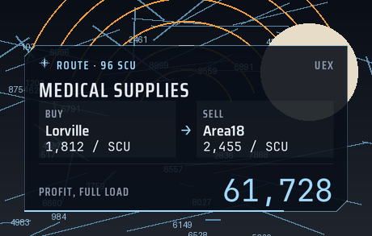
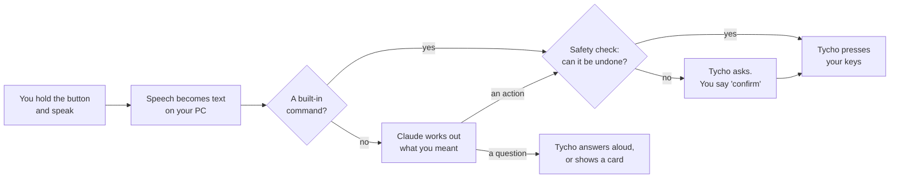

# Tycho

**An unofficial voice co-pilot for Star Citizen®, and an advisor for World of Warcraft: Forever.**

> Named after Tycho Brahe, who charted the stars with unmatched precision before the telescope existed.

Hold a button and say what you want, the way you'd say it to a crewmate. Tycho presses the right keys through your own keybinds, tells you what it did, answers questions from live game data, and asks before doing anything you can't undo.



*The Tile: the one answer to act on, shown over the game, then gone. (Drawn by Tycho's preview tool over a sample background.)*

## At a glance

| | |
|---|---|
| **What you need** | A Windows PC and a microphone. Star Citizen or World of Warcraft: Forever. |
| **What it costs** | Tycho is free and open source. The built-in commands need no account. Understanding anything said differently, and answering questions, uses your own Claude key: usually a few cents an evening. A spoken voice uses your own ElevenLabs key. Details in [Keys and costs](#keys-and-costs). |
| **Is it allowed?** | In Star Citizen, Tycho only presses keys through your own keybinds, and only when you ask. It never reads the game's memory or changes the game. Voice tools that work this way have been used for years, and we have found no report of a ban for one. But CIG has not reviewed or approved Tycho, and its terms forbid "macro" software in general, so nobody can promise there is no risk ([how Tycho stays within the rules](docs/adr/0003-staying-within-cig-rules.md)). In World of Warcraft: Forever, Tycho presses no keys at all: it only answers and advises, as Blizzard's rules require. |
| **How finished is it?** | Pre-alpha (0.8). It works, but it's early and has been played mostly by its maintainer: expect rough edges and changes between versions. |
| **Your privacy** | Your voice never leaves your PC. Only text goes out, to the services you gave a key for. Nothing about how you use Tycho is tracked. [The full list](#what-leaves-your-pc). |

## Why Tycho

Your job is to play. Star Citizen hands you two other jobs on top: hundreds of actions, many on keys you set up once and forgot, and the facts you need (prices, routes, recipes, ship specs), which live on wikis one alt-tab away from the cockpit. Both pull you out of the moment you came for.

Tycho takes those two jobs. You say what you want and keep flying. You stay in the seat and make every call that matters; Tycho does the remembering and the looking up.

**How one request travels:**



**What makes it different:**
- **It reads your real keybinds,** so it presses what you bound and never guesses a key. It tells you when an action has no key.
- **Live data, not memory.** Prices, routes, ships and recipes come from this patch's game files, UEX and the Star Citizen Wiki, and it says where an answer came from.
- **The Tile.** The one answer to act on, shown over the game, then gone. Never a chat window to read.
- **Safe by design.** Nothing you can't undo happens without "confirm", and that check sits outside the AI, so nothing the AI picks can skip it.
- **Your agent can set it up.** If you use Claude Code, Codex or a similar agent, say "set up Tycho" and let it.
- **Open source** (Apache-2.0), so you can read exactly what leaves your PC.

## Install

1. **Download** `TychoSetup-<version>.exe` from the [latest release](https://github.com/benshapyro/tycho-ai/releases/latest).
2. **Run it.** Tycho isn't code-signed yet, so Windows SmartScreen says it's from an unknown publisher: choose **More info**, then **Run anyway**. To check the file first, each release lists the installer's SHA-256; `Get-FileHash TychoSetup-<version>.exe` in PowerShell shows yours, and the two should match. It installs for you only, with no administrator prompt.
3. **Follow Tycho's window.** It opens by itself and walks you through five steps: your game, your keys (you can skip them and add them later), your push-to-talk button, microphone and voice, what leaves your PC, and a first thing to try.
4. **Press Start, switch to the game, and talk.** The first start downloads the speech model (0.7 GB), once.

After that, open Tycho from the Start menu. Its star sits by the clock while it runs; click it for Tycho's window. Uninstalling keeps your settings, keys and the speech model.

For the Tile to show over the game, the game must run in a borderless window: Borderless Window mode in Star Citizen's graphics settings, or Windowed (Fullscreen) in World of Warcraft: Forever.

Developers can also [install from source](docs/current/players-guide.md#install-from-source), or have [an AI agent set it up](#set-up-with-an-ai-agent).

## Your first five minutes

No keys yet? You can still try the built-in commands, said the usual way. In Star Citizen, sit in your ship, hold your push-to-talk button, speak, and let go:

- "Gear down." "Lights on." "Open the doors."
- "Flight ready." "Request landing."

You hear **a click** when the keys were pressed, **a low tone** when they weren't, and **two rising notes** when Tycho has a question for you. Pressing push-to-talk again stops it at any point.

With a Claude key, say it your own way, and ask questions:

- "Put the wheels out." "Take us down to the pad."
- "Where's the best place to sell quantanium?"
- "Best trade route from Lorville with 96 SCU?"
- "I own a Cutlass Black." Then: "Which of my ships is best for mining?"
- "Make the Tile bigger." "Turn your voice down a bit." "Say that again."

Anything you can't undo asks first ("Eject? Say confirm."). Say "confirm" within 5 seconds, or anything else to drop it.

**What to say** in Tycho's window lists every command with your key for it, and lets you add your own phrases. The [player's guide](docs/current/players-guide.md) covers the rest.

## Keys and costs

A key is a password for an online service, from your own account there. You paste it into Tycho's setup once; Tycho stores it in Windows Credential Manager, never in a file, and it's only ever sent to the service it belongs to.

| Key | What it adds | What it costs (your own account) |
|---|---|---|
| None | The built-in commands, said the usual way, with a click or a tone for each | Free |
| [Anthropic](https://console.anthropic.com) (Claude) | Anything said differently, misheard words, two-part requests, and questions | About $0.0002 a request, plus about $0.002 each time Tycho starts. An evening of play is usually a few cents. |
| [OpenRouter](https://openrouter.ai) (instead of Anthropic) | The same Claude, through one OpenRouter key: set `brain_provider = "openrouter"`. With an OpenRouter key, web search runs through it too (about half a cent a search), whichever runs the brain. | About what Anthropic charges, on your OpenRouter credit |
| [ElevenLabs](https://elevenlabs.io) (voice) | Tycho speaks its answers, what it did, and its questions. The key needs text-to-speech permission. | About 0.5 credits a character: a chatty hour is about 4,000 credits. The free plan is non-commercial and requires attribution. |

Without an ElevenLabs key, Tycho's replies are shown in its window and it plays its sounds instead.

**Getting a key, and keeping the cost capped:**
- **Claude (Anthropic):** make an account at [console.anthropic.com](https://console.anthropic.com), buy a small amount of credit (the smallest amount lasts a long time at a few cents an evening), create an API key, and paste it into Tycho's Keys step. The credit is prepaid, so leave auto-reload off and you can never spend more than you bought.
- **Voice (ElevenLabs):** make an account at [elevenlabs.io](https://elevenlabs.io), create an API key with text-to-speech permission, and paste it in. Your plan's monthly credits are the cap.
- Tycho checks each key when you store it and tells you in plain words if something is wrong with it.

## What it does today

- **Almost 90 built-in commands** that run instantly on your PC, through your own keybinds. Add your own phrases and sequences. Ask which key does something ("what's my strafe key?") and it names yours.
- **Claude for anything said differently,** for multi-step requests ("flight ready and request landing"), and for questions. It takes about 1.3 seconds.
- **Answers from live data:** ships from the current patch's game files; trade prices, routes, refining and where to buy a ship from UEX; mining, weapons, armor, components and crafting from the Star Citizen Wiki; news and upcoming patches from RSI's sites; and "where is" and "how do I" from the web, with community answers marked as such.
- **Knows your fleet,** so "which of my ships is best for mining?" is about your ships.
- **Spoken replies** in a voice you choose, with the game turned down while Tycho speaks, and sounds that tell you whether the keys went in.
- **Asks before anything you can't undo,** and when a request is vague ("faster") it asks instead of guessing. What you say to your squad on the same button ("break right") presses nothing.
- **The Tile:** a small see-through panel over the game for what's better read than heard: prices, routes, specs, recipes, steps.
- **Advisor mode:** turn key actions off and Tycho only answers and advises. **World of Warcraft: Forever** always works this way: ask about classes, dungeons, professions and more.
- **Looks at the game window when you ask,** if you turned it on: "take a look". Only the game's own window, with a camera click each time, and the picture is never saved.
- **Reads the game's log** on your PC, so it knows your ship, the zone you're in and whether you've plotted a quantum route. Speaking up comes from it, and the safeguards use a plotted route to know you're in the pilot seat.
- **Speaks up when you want it to,** about a few things the game's log records, such as a quantum jump ending or entering an armistice zone. Off until you pick which.
- **Settings by voice,** with "undo". By voice a safeguard can only get stricter, never looser.
- **Its own window and tray icon:** guided setup, whether Tycho is ready and listening, everything you can say, and every setting.
- **A log of every key it pressed,** and crash reports only if you say yes.

Each of these is explained in the [player's guide](docs/current/players-guide.md). What changed in each version is in the [changelog](CHANGELOG.md).

## What leaves your PC

In short:
- **Your voice never leaves your PC.** Speech is turned into text on your PC.
- **Only text is sent, and only to services you gave a key for:** what you said goes to Claude, and what Tycho says goes to ElevenLabs. The one exception is a picture of the game window, only if you turned looking on and only when you ask Tycho to look.
- **Tycho counts and tracks nothing about how you use it.** Crash reports are sent only if you say yes.

The full list:

| Service | What it receives | When |
|---|---|---|
| Anthropic (Claude) | What you said (as text); your bound actions with their keys, your commands and sequences; and your last few requests with what Tycho did, if they were in the last 30 seconds | Requests the built-in commands don't handle, plus one warm-up request when Tycho starts |
| Anthropic or OpenRouter (whichever runs the brain) | Your memory notes: the short notes you asked Tycho to remember, for every game and for the game you're playing. They're kept on your PC in `memory.toml` files you can read and edit, and on the Memory page | With each request to the brain, unless memory is off (`memory = false`, or say "turn memory off"). Never in crash reports |
| OpenRouter, instead of Anthropic | The same as Anthropic (Claude) above. OpenRouter forwards it to Anthropic, who runs the model, so both receive it | Only with `brain_provider = "openrouter"`, instead of sending it to Anthropic directly |
| ElevenLabs | The text Tycho speaks; at start, which voice you chose, to check your key can use it | When Tycho speaks, and once when it starts |
| The key's own provider (Anthropic, OpenRouter or ElevenLabs) | A key you store, to check it works | When you store it, and when you run `tycho check` |
| Star Citizen Wiki API, UEX Corp | Nothing about you: Tycho downloads their ship lists | On first run, and when a new patch goes live |
| OpenRouter and Perplexity (web search, with an OpenRouter key) | A short search query Claude writes from your question. OpenRouter passes it to Perplexity's search and the results to Claude on Anthropic, and asks both to keep nothing | Questions about news, upcoming patches, events and new ships, and where something is or how to do something when Tycho's look-ups don't cover it; off with `web_search = false`. Any website; `web_search_open = false` keeps it to the Star Citizen sites. Whenever you've stored an OpenRouter key, whichever runs the brain |
| Anthropic (web search, with only an Anthropic key) | The same search query | The same questions. The Star Citizen sites first; when they have no clear answer, any website, and Anthropic reads up to two of the pages it finds (never Reddit's pages, only its search snippets); `web_search_open = false` keeps it to the Star Citizen sites |
| UEX Corp | Which commodity or trading place you asked about | Trade questions |
| Star Citizen Wiki API | The item names you ask about | Weapon, armor, component and crafting questions |
| GitHub | Nothing about you: Tycho asks whether a newer version is out | When Tycho starts and when its window opens, off with `check_for_updates = false`; and when you press **Check for updates** |
| Hugging Face | Nothing about you: Tycho downloads its speech model | Once, the first time Tycho starts |
| Sentry (crash reports) | Only if you said yes: the kind of error and where in Tycho's own code it happened, Tycho's version, the Windows version, the game and the brain provider. Never what you or Tycho said, your keys, your name, your files or folders, or anything that identifies you or your PC | The next time Tycho starts after a crash. Saying no deletes any report still waiting |
| Anthropic (Claude), or OpenRouter instead | A picture of the game's own window (never the desktop or another window), with your question. Never saved or logged | Only if you said yes to looking (`look_at_screen`, off until you do), and only when you ask Tycho to look ("take a look") or say yes when it offers. You hear a camera click each time |

## Set up with an AI agent

If you use an AI agent on your PC (Claude Code, Codex, Cursor, Gemini CLI or another), it can install and set up Tycho for you. It runs the installer and Tycho's checks, and fixes what they find. It opens a window when it needs you: to paste an API key, which it never sees, or to press your push-to-talk button.

**Any agent:** paste this.

> Set up Tycho, the Star Citizen voice co-pilot, on this PC. Follow https://raw.githubusercontent.com/benshapyro/tycho-ai/main/plugins/tycho/skills/tycho-setup/SKILL.md

**Claude Code:** install Tycho's skills once, then ask it to "set up Tycho", or to "add a voice command for space mode".

```
/plugin install tycho --marketplace benshapyro/tycho-ai
```

On older versions of Claude Code, that's `/plugin marketplace add benshapyro/tycho-ai`, then `/plugin install tycho@tycho`.

**Codex and others that read `~/.agents/skills`:** copy the folders in [plugins/tycho/skills](plugins/tycho/skills) there.

The skills are [tycho-setup](plugins/tycho/skills/tycho-setup/SKILL.md) (install, keys, button, downloads, first run) and [tycho-commands](plugins/tycho/skills/tycho-commands/SKILL.md) (your own phrases and sequences, and why Tycho didn't understand something). For the agent, `tycho check --json` lists what's left to do, `tycho model download` gets the speech model, and `tycho actions <words>` finds the game's action names.

Your agent does this by running commands on your PC: the same installer and checks you would run yourself. Read what it proposes before you approve it.

## Coming

These are plans, not promises. Each links its issue.

- **Your fleet and logs in Tycho's window** ([#12](https://github.com/benshapyro/tycho-ai/issues/12)).
- **Learns from misses and fixes itself** ([#51](https://github.com/benshapyro/tycho-ai/issues/51)): offers to add phrases you rephrased, and repairs keybinds after a patch, always with your OK.
- **An optional wake word** ([#3](https://github.com/benshapyro/tycho-ai/issues/3)).

## Principles

- **Protect the player's attention.** Every feature is judged by whether it keeps you in the game.
- **Receipts, not claims.** Every action is logged: what was pressed, and whether you confirmed it.
- **Fast where it matters.** Known commands skip the AI entirely.
- **Asks before the irreversible.** The safety gate is separate from the AI: nothing Claude picks can skip a confirmation.
- **Plays by the rules.** It sends keypresses through your keybinds only. It never reads game memory or injects into the game. Every action starts from you; there's no unattended automation.
- **Private by default.** Your voice stays on your PC, your keys stay in Windows Credential Manager, and nothing about how you use Tycho is tracked.
- **Built for your agent too.** Everything setup does, an AI agent can do through Tycho's command line and skills, with the same checks.
- **Measured, not claimed.** The brain is scored on a test set before every change that touches it; the bar is zero wrong key presses. The numbers, and their limits, are in [How Tycho was built](docs/current/how-tycho-was-built.md).

## Building and contributing

- **[How Tycho was built](docs/current/how-tycho-was-built.md):** the engineering behind it, what was measured, what failed, and how the work is split between the maintainer and AI coding agents.
- **[CONTRIBUTING.md](CONTRIBUTING.md):** how to set up, where to start, and what a pull request needs.
- **[docs/architecture.md](docs/architecture.md)** for the design, and **[docs/adr](docs/adr)** for the decisions behind it.

## Credits

Speech recognition uses NVIDIA's [Parakeet TDT 0.6B v2](https://huggingface.co/nvidia/parakeet-tdt-0.6b-v2) model (CC-BY-4.0), via [onnx-asr](https://github.com/istupakov/onnx-asr). Ship and vehicle data comes from the [Star Citizen Wiki API](https://api.star-citizen.wiki), downloaded to your PC once per patch; its in-game prices are reported by players to [UEX Corp](https://uexcorp.space), which also lists the ships still in concept and provides the commodity prices and trade routes. Web search answers can draw on [starcitizen.tools](https://starcitizen.tools) (CC BY-SA 4.0). The window and the Tile use the Saira and Share Tech Mono fonts (SIL Open Font License). `tycho credits` shows these in the app, and the installer includes them.

## Licence

[Apache-2.0](LICENSE).

---

This is an unofficial Star Citizen fan project, not affiliated with the Cloud Imperium group of companies. All content in this project not authored by its host or users is property of its respective owners. Star Citizen®, Roberts Space Industries® and Cloud Imperium® are registered trademarks of Cloud Imperium Rights LLC. Visit the official site at [robertsspaceindustries.com](https://robertsspaceindustries.com).
